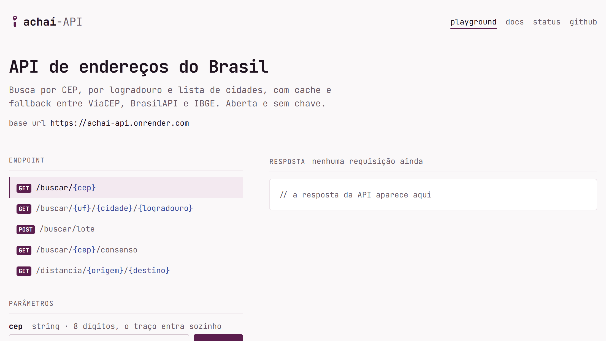

  

<h1 align="center">achaí-API</h1>

  
  
  
  

Aplicação web que busca endereços brasileiros pelo CEP ou pelo nome da rua. O back-end é uma API em C#/.NET, e o front é um app em Angular.

  <b><a href="https://achai-api.vercel.app">Experimente a demo</a></b>
  &nbsp;•&nbsp;
  <a href="https://achai-api.vercel.app/docs">Documentação da API</a>
  &nbsp;•&nbsp;
  <a href="docs">Guias</a>
  &nbsp;•&nbsp;
  <a href="docs/decisions">Decisões de arquitetura</a>

## Destaques

- **CEP ou rua:** busca pelo CEP, por vários CEPs de uma vez ou pelo nome da rua, tolerante a erro.
- **Duas fontes:** consenso entre o ViaCEP e a BrasilAPI, que assume quando o ViaCEP falha numa busca por CEP.
- **Playground da API:** escolha do endpoint, exemplo de chamada em curl, fetch e C# e a resposta com status, tempo e JSON.
- **Para outros programas:** SDKs para .NET e TypeScript gerados do OpenAPI e um servidor MCP para assistentes de IA.
- **De olho nas fontes:** testes de contrato semanais contra as APIs reais, que abrem uma issue quando algo muda.

## Como foi feito

O projeto começou como uma API simples que repassava as respostas do ViaCEP e foi reconstruído em etapas, cada uma com a decisão registrada num ADR.

<b>A reconstrução:</b> etapa por etapa

- **API em vertical slices:** cada rota é uma fatia completa (rota, validação e handler), e as fontes externas ficam atrás de interfaces.
- **Erros previsíveis:** CEP inexistente ou parâmetro inválido viram respostas padronizadas (ProblemDetails), com mensagens em português; erro inesperado vira um 500 genérico, com o detalhe só no log.
- **Robustez nas fontes externas:** cache em memória, timeout, retry e circuit breaker em cada chamada, e a BrasilAPI assume quando o ViaCEP falha numa busca por CEP.
- **Contrato compartilhado:** o front usa tipos gerados a partir do documento OpenAPI da API, então uma mudança na API quebra o build do front, e não a tela.
- **Mais que a busca:** vários CEPs de uma vez, consenso entre o ViaCEP e a BrasilAPI, busca por rua tolerante a erro, endereço normalizado, coordenadas, distância entre CEPs, página de status das fontes, um servidor MCP para assistentes de IA e SDKs para .NET e TypeScript gerados do OpenAPI.
- **Testes em camadas:** unitários e de integração sem rede em todo pull request, e testes de contrato semanais contra as APIs reais, que abrem uma issue quando algo muda.
- **Interface:** um playground da API, com a escolha do endpoint, o exemplo de chamada em curl, fetch e C# e a resposta com status, tempo e JSON, e uma página de documentação gerada do OpenAPI, em tema claro, com a paleta Açaí por cima de tokens de design próprios (cores, tipografia e espaçamento).

## Tecnologias

- **API:** .NET 10 e ASP.NET Core.
- **Front:** Angular.
- **Fontes de dados:** ViaCEP, BrasilAPI e IBGE.
- **Entrega:** Docker e GitHub Actions.

---

Licença [MIT](LICENSE) · Feito por [Gustavo Victor](https://github.com/guavovic)
